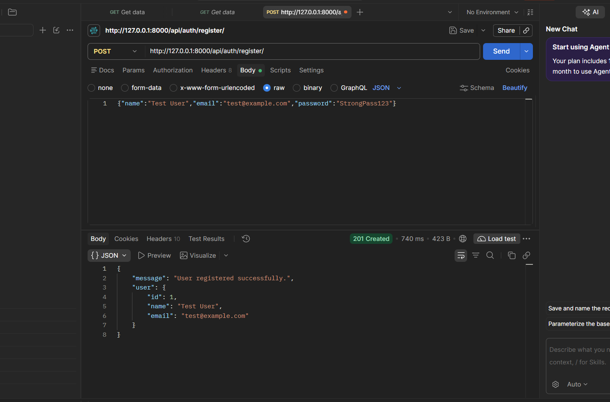
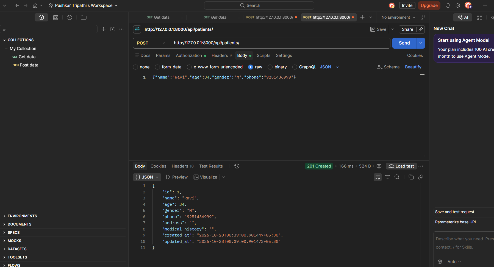
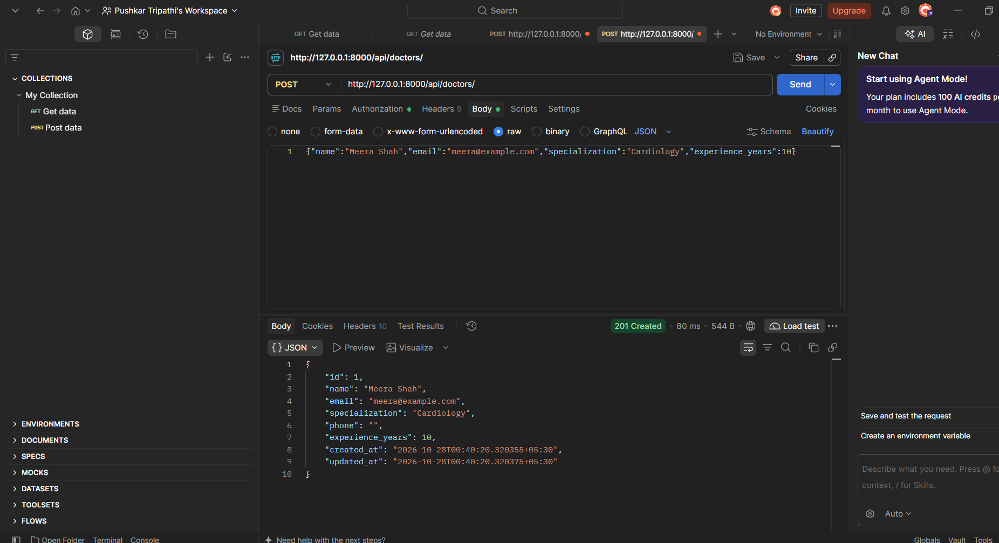
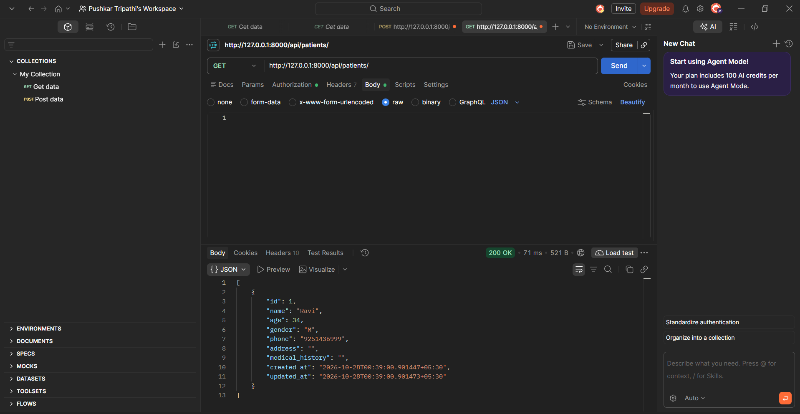
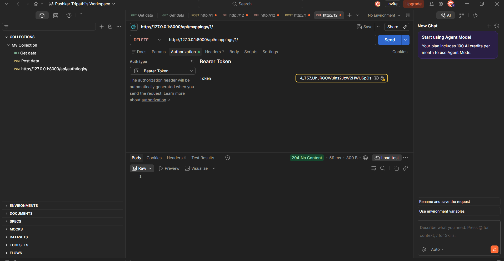
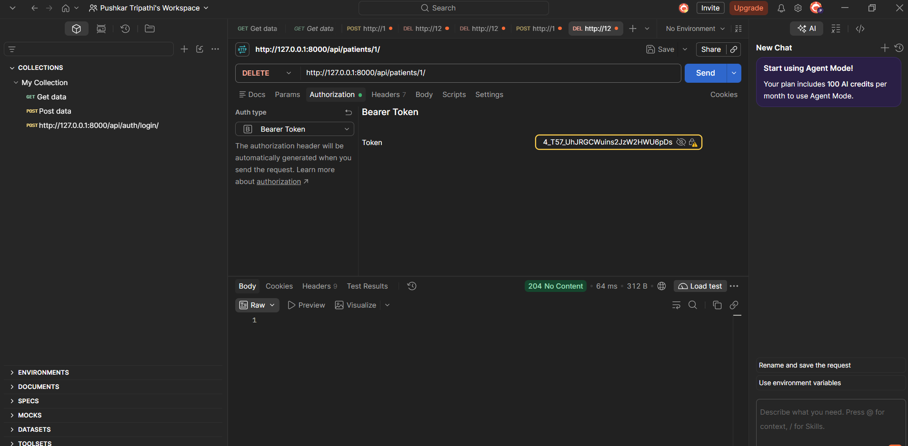
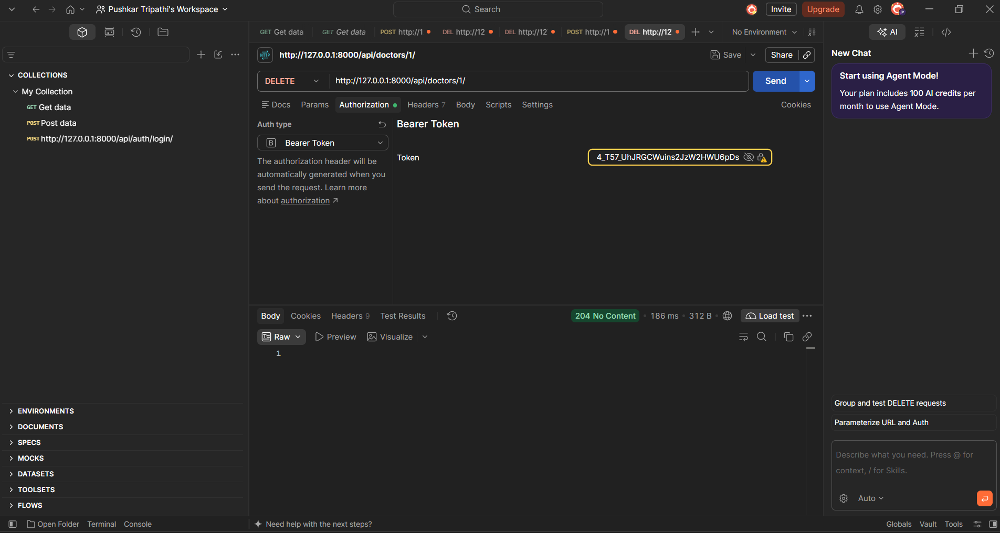

# Healthcare Backend (Django + DRF + PostgreSQL + JWT)

REST API to register/login users and manage patients, doctors and patient-doctor mappings.

**Author:** Pushkarpati  Tripathi
**Assignment:** Full-stack Developer Internship, Whatbytes

## Tech Stack
Django, Django REST Framework, PostgreSQL, djangorestframework-simplejwt, python-decouple

## Setup

```bash
python -m venv venv
source venv/bin/activate        # Windows: venv\Scripts\activate
pip install -r requirements.txt

cp .env.example .env            # Windows: copy .env.example .env, then edit values (SECRET_KEY, DB_*)
```

Create the database in PostgreSQL:

```sql
CREATE DATABASE healthcare_db;
```

Run migrations and start the server:

```bash
python manage.py makemigrations accounts patients doctors mappings
python manage.py migrate
python manage.py runserver
```

## Endpoints

| Method | URL | Description |
|---|---|---|
| POST | `/api/auth/register/` | Register (name, email, password) |
| POST | `/api/auth/login/` | Login, returns JWT access + refresh |
| POST | `/api/auth/token/refresh/` | Refresh access token |
| POST / GET | `/api/patients/` | Create / list your patients |
| GET / PUT / DELETE | `/api/patients/<id>/` | Patient detail |
| POST / GET | `/api/doctors/` | Create / list all doctors |
| GET / PUT / DELETE | `/api/doctors/<id>/` | Doctor detail (edit/delete by creator only) |
| POST / GET | `/api/mappings/` | Assign doctor to patient / list mappings |
| GET | `/api/mappings/<patient_id>/` | Doctors assigned to a patient |
| DELETE | `/api/mappings/<id>/` | Remove a mapping |

All endpoints except register/login need the header `Authorization: Bearer <access_token>`.

## Example requests

```bash
curl -X POST localhost:8000/api/auth/register/ -H "Content-Type: application/json" \
  -d '{"name":"Asha","email":"asha@example.com","password":"StrongPass123"}'

curl -X POST localhost:8000/api/auth/login/ -H "Content-Type: application/json" \
  -d '{"email":"asha@example.com","password":"StrongPass123"}'

curl -X POST localhost:8000/api/patients/ -H "Authorization: Bearer <TOKEN>" \
  -H "Content-Type: application/json" \
  -d '{"name":"Ravi","age":34,"gender":"M","phone":"9999999999"}'

curl -X POST localhost:8000/api/doctors/ -H "Authorization: Bearer <TOKEN>" \
  -H "Content-Type: application/json" \
  -d '{"name":"Meera Shah","email":"meera@example.com","specialization":"Cardiology","experience_years":10}'

curl -X POST localhost:8000/api/mappings/ -H "Authorization: Bearer <TOKEN>" \
  -H "Content-Type: application/json" -d '{"patient":1,"doctor":1}'
```

## Design notes
- Patients are private to the user who created them; mappings are scoped to the user's patients.
- Doctors are readable by all authenticated users; only the creator can edit/delete.
- Duplicate patient-doctor assignments are rejected (unique constraint).
- Errors use a uniform `{"success": false, "errors": {...}}` shape.
- Secrets/DB config come from environment variables (`.env`, git-ignored).

## API Test Screenshots

**Register (201)**



**Create patient (201)**



**Create doctor (201)**



**List patients (200)**



**Delete mapping (204)**



**Delete patient (204)**



**Delete doctor (204)**




## What I would improve next
- Add pagination and search on the patient and doctor lists
- Add automated tests for the auth and mapping flows
- Add Swagger/OpenAPI docs
- Add a logout endpoint with token blacklisting
